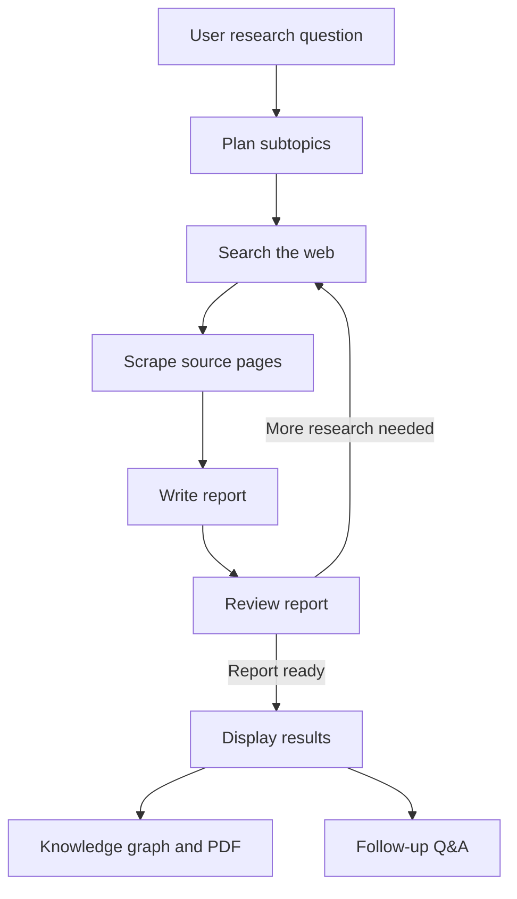

# Agentic Researcher

An autonomous web-research application built with **Python, LangGraph, Mistral AI, and Chainlit**. It takes a research question, breaks it into subtopics, searches the web, collects source content, drafts a report, and provides generated research artifacts.

## Features

- **Research planning:** Uses an LLM-driven planning step to break a broad question into focused subtopics.
- **Graph-based workflow:** Orchestrates planning, research, scraping, report writing, and review through LangGraph.
- **Web search:** Retrieves candidate pages through the Serper search API.
- **Web scraping:** Collects page content through the Browserless API.
- **Report generation:** Produces a research report from the collected material.
- **Knowledge graph:** Generates an interactive HTML visualization of entities and their relationships using NetworkX and PyVis.
- **PDF export:** Creates a downloadable PDF version of the report.
- **Follow-up Q&A:** Uses the collected research data and ChromaDB-backed retrieval to support follow-up questions in the Chainlit interface.

## Workflow



## Tech Stack

| Area | Technologies |
|---|---|
| Language | Python |
| Agent workflow | LangGraph, LangChain |
| Language model | Mistral AI (`langchain-mistralai`) |
| User interface | Chainlit |
| Web search | Serper API |
| Web scraping | Browserless API, Requests, BeautifulSoup |
| Vector store / retrieval | ChromaDB, LangChain integrations |
| Knowledge graph | NetworkX, PyVis |
| PDF generation | xhtml2pdf |

## Project Structure

```text
Agentic-Researcher/
├── agent_graph/
│   ├── __init__.py
│   ├── global_state.py   # Shared vector-store state and helpers
│   ├── graph.py          # LangGraph workflow definition and execution
│   ├── nodes.py          # Planning, research, scraping, writing, and review nodes
│   └── states.py         # Agent workflow state definitions
├── app/
│   ├── __init__.py
│   └── app.py            # Chainlit application entry point
├── tools/
│   ├── __init__.py
│   ├── search.py         # Serper search integration
│   └── scraper.py        # Browserless/web-page scraping integration
├── utils/
│   ├── __init__.py
│   ├── graph_viz.py      # Interactive knowledge graph generation
│   └── pdf_gen.py        # PDF report generation
├── example.env           # Environment-variable template (no real keys)
├── requirements.txt
└── README.md
```

## Prerequisites

- Python 3.10 or a compatible version supported by the dependencies
- A Mistral AI API key
- A Serper API key
- A Browserless API key

## Setup

### 1. Clone the repository

```bash
git clone https://github.com/<your-username>/<your-repository>.git
cd <your-repository>
```

### 2. Create and activate a virtual environment

**Windows (PowerShell):**

```powershell
python -m venv .venv
.venv\Scripts\Activate.ps1
```

**macOS / Linux:**

```bash
python3 -m venv .venv
source .venv/bin/activate
```

### 3. Install dependencies

```bash
python -m pip install --upgrade pip
pip install -r requirements.txt
```

### 4. Configure API keys

Create a file named `.env` in the project root. You can use `example.env` as a reference:

```env
MISTRAL_API_KEY=your_mistral_api_key
SERP_API_KEY=your_serper_api_key
BROWSERLESS_API_KEY=your_browserless_api_key
```

Keep `.env` private. **Never commit API keys or other secrets to GitHub.**

### 5. Run the application

From the project root, run:

```bash
chainlit run app/app.py
```

Chainlit will display the local address for opening the application in your browser.

## How to Use

1. Start the Chainlit application.
2. Enter a research question in the chat interface.
3. Let the agent plan the research and gather relevant web content.
4. Review the generated report.
5. Open or download the generated knowledge graph and PDF report when available.
6. Ask follow-up questions using the research collected during the session.

## Configuration and Notes

- API credentials are loaded from the `.env` file using `python-dotenv`.
- Search, scraping, LLM, vector-store, and report-generation features depend on their respective services and installed packages being configured correctly.
- The application uses in-memory LangGraph checkpointing; checkpoint data is not a persistent conversation history across application restarts.
- Validate API quotas, provider pricing, and current service requirements before running large research jobs.

## Current Scope and Limitations

This repository contains the application source code and dependency list. It does not include automated tests, a production deployment setup, or a CI pipeline. The application should be tested with valid API credentials and representative research questions before being treated as production-ready.

## Security

- Do not upload `.env`, API keys, access tokens, or private research data.
- Rotate any credential immediately if it is accidentally exposed.
- Use environment variables or a secrets manager for deployment.

## License

No license file is currently included. Add a license before presenting the repository as open source or allowing reuse by others.
